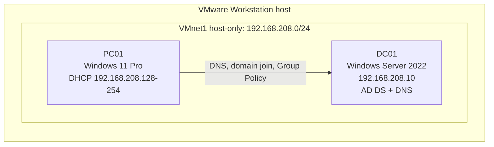

# Active-Directory-Home-Lab
Hands-on IT lab using Windows Server 2022, Active Directory, DNS, Group Policy, and Windows 11 Pro in VMware Workstation Pro.

**Author:** Tadeh Sarkiskian
**Date:** October 2026
**Platform:** VMware Workstation Pro (isolated host-only network)
**Full step-by-step guide:** [docs/tutorial.md](docs/tutorial.md)

---

## 1. Summary

I built an isolated Active Directory environment in VMware to practice core Windows administration tasks. The lab includes a Windows Server 2022 domain controller (DC01) running AD DS and DNS, a Windows 11 Pro client (PC01) joined to the domain, a domain user account, an Organizational Unit (OU), and a Group Policy Object (GPO) that displays a logon banner on the client. I verified each stage with command-line tools and the Active Directory and Group Policy consoles, and I documented the problems I ran into and how I solved them.

**Skills demonstrated:** virtualization and network isolation, Windows Server installation, static IP and DNS configuration, AD DS deployment (new forest), domain joins, user and computer object management, OU design, Group Policy, and troubleshooting.

## 2. Objectives

- Build a realistic domain environment without touching any production system.
- Practice the full path from a bare virtual machine to a domain-joined client receiving Group Policy.
- Get hands-on experience diagnosing and fixing the problems that come up during setup.

## 3. Environment and Architecture

| Item | DC01 (server) | PC01 (client) |
|---|---|---|
| Operating system | Windows Server 2022 Standard Evaluation (Desktop Experience) | Windows 11 Pro |
| Role | Domain controller, DNS server | Domain-joined workstation |
| vCPU / RAM / disk | 2 / 4 GB / 60 GB | 2 / 4 GB / 80 GB |
| Network adapter | Host-only (VMnet1) | Host-only (VMnet1) |
| IP configuration | Static: 192.168.208.10 / 255.255.255.0 | DHCP (VMware range 192.168.208.128-254); DNS set manually to 192.168.208.10 |

- **Hypervisor:** VMware Workstation Pro (host with 16 GB RAM or more)
- **Network:** VMnet1, host-only, subnet 192.168.208.0/24. The VMware DHCP pool is 192.168.208.128-254, so addresses 1-127 are left free for static assignment.
- **Domain:** `ad.tadehlab.test` (NetBIOS name `TADEHLAB`), forest and domain functional level Windows Server 2016

## 4. What I Implemented

### 4.1 Isolated virtual network
I configured VMnet1 as a host-only network so the lab VMs can talk to each other but not to the internet or my home network. I noted the DHCP pool so I could place the server's static address outside it and avoid conflicts.

### 4.2 Domain controller (DC01)
- Created the VM with 4 GB RAM, 2 vCPUs and a 60 GB disk, then installed Windows Server 2022 Standard Evaluation with the Desktop Experience.
- Installed VMware Tools to fix the display resolution.
- Assigned the static address 192.168.208.10 and pointed the server's DNS setting at itself. The default gateway was left empty because the network is isolated.
- Renamed the server to DC01 before promotion.

### 4.3 Active Directory Domain Services and DNS
- Installed the AD DS role and promoted the server to a domain controller in a **new forest**, `ad.tadehlab.test`. The `.test` top-level domain is reserved for testing, so it cannot collide with a real internet domain.
- Set a separate Directory Services Restore Mode (DSRM) password for recovery.
- Left "Create DNS delegation" unchecked, because a brand-new private domain has no parent zone to delegate from.
- DNS was configured automatically during promotion; I confirmed the `ad.tadehlab.test` forward lookup zone and its `_msdcs`, `_sites`, `_tcp` and `_udp` records.

### 4.4 Domain user and client (PC01)
- Created the domain user `lab.user` (TADEHLAB\lab.user).
- Built PC01 with a virtual TPM (VMware encrypts the files that support it). Because the network is isolated, I used `OOBE\BYPASSNRO` to complete the Windows 11 setup without an internet connection.
- Renamed the machine, pointed its DNS at DC01 (192.168.208.10), and joined it to `ad.tadehlab.test` using the domain Administrator account.
- Signed in as `TADEHLAB\lab.user` and confirmed the domain account worked.

### 4.5 Organizational Unit and Group Policy
- Created an OU named **Lab Workstation** with protection from accidental deletion enabled, and moved the PC01 computer object into it.
- Created and linked a GPO named **Workstation Baseline** to that OU. It sets two Security Options: a logon message title ("Authorized Access Only") and message text ("This computer is part of the TADEHLAB domain. Use only your authorized account.").
- Applying the policy to an OU instead of the whole domain keeps the scope limited to the machines it is meant for.

## 5. Problems and Troubleshooting

| # | Symptom | Diagnosis and fix |
|---|---|---|
| 1 | Windows Server setup stopped with "Windows cannot find the license terms." | VMware's Easy Install had attached an unattended-setup floppy image (`autoinst.flp`) to the VM. I powered the VM off, removed the Floppy device in the VM settings, restarted, and pressed a key at the "boot from CD or DVD" prompt. Setup then ran manually and completed. |
| 2 | The server desktop appeared in a small window and would not resize. | The VM was missing VMware Tools. I installed them from VM > Install VMware Tools, restarted, and the display scaled to full screen. I repeated the same fix on PC01. |
| 3 | Windows 11 setup required a network connection, which an isolated host-only network cannot provide. | At the network screen I opened a command prompt with Shift+F10 and ran `OOBE\BYPASSNRO`. After the restart, the "I don't have internet" option appeared and I could create a local account. |
| 4 | `nslookup` returned the correct IP but also showed "DNS request timed out" and a server name of `UnKnown`. | Forward lookup of `dc01.ad.tadehlab.test` worked, so DNS resolution for the domain was fine. The `UnKnown` server name most likely means there is no reverse lookup zone (PTR record) for 192.168.208.10. I left it as is, and creating a reverse zone is on my next-steps list. |

## 6. Verification

| Check | Command or tool | Result |
|---|---|---|
| Static IP and computer name on DC01 | `ipconfig`, `whoami` | 192.168.208.10; `dc01\administrator` |
| Domain exists | Active Directory Users and Computers | `ad.tadehlab.test` listed |
| DNS zone created | DNS Manager | `ad.tadehlab.test` zone with `_msdcs`, `_sites`, `_tcp`, `_udp` |
| Name resolution from DC01 and PC01 | `nslookup dc01.ad.tadehlab.test` | Returned 192.168.208.10 |
| Domain logon on PC01 | `whoami` | `tadehlab\lab.user` |
| PC01 registered in the domain | Active Directory Users and Computers | PC01 listed under Computers |
| GPO applied to PC01 | `gpupdate /force`, `gpresult /scope computer /r` | "Workstation Baseline" listed under Applied Group Policy Objects |
| Policy effect | Restart PC01 | Logon banner "Authorized Access Only" displayed |

## 7. Security Notes

- The built-in Administrator and DSRM passwords are different, and neither is used for day-to-day logons.
- The lab is isolated on a host-only network with no internet access.
- The OU is protected from accidental deletion.
- For convenience in the lab, I disabled "User must change password at next logon" for `lab.user`. In a production environment I would leave it enforced.
- `lab.user` was created in the default Users container. In a real environment I would create department OUs and place users there so Group Policy can be scoped properly.

## 8. Lessons Learned

- DNS is the foundation of Active Directory. The client could only join the domain after its DNS setting pointed at the domain controller.
- Verifying each stage (`ipconfig`, `nslookup`, `whoami`, `gpresult`) before moving to the next one made problems much easier to isolate.
- Many setup problems are caused by hypervisor settings (such as the Easy Install floppy), not by Windows itself.
- Linking a GPO to a purpose-built OU makes policy scope easy to understand and test.

## 9. Next Steps

- Add a reverse lookup zone and PTR records.
- Design a department-based OU structure with security groups and role-based access.
- Move DHCP from VMware to a Windows Server DHCP role on DC01.
- Add a password policy and additional security GPOs, for example a screen-lock timeout.
- Create file shares with NTFS permissions tied to groups.
- Automate bulk user creation with PowerShell.
- Add a second domain controller to practice replication, and take VM snapshots before each major change.

---

## Appendix

The complete step-by-step guide, with all settings and screenshots, is in [docs/tutorial.md](docs/tutorial.md).