# Active Directory Home Lab: Step-by-Step Tutorial

## Objectives

This simple lab is hands-on practice to improve IT skills. It covers downloading and configuring Windows Server and Windows 11 Pro, joining them to a domain with Active Directory, configuring Group Policy, and troubleshooting problems.

---

## Phase 1 - Download the Required Software

For this lab, we need one software program and two operating systems.

1. Make sure you have at least 16 GB of RAM.
2. Choose a virtualization program: [VMware](https://www.vmware.com) (recommended; I use it in this lab) or [VirtualBox](https://www.virtualbox.org). Both are free.
3. Go to Microsoft's website and download [Windows Server 2022](https://www.microsoft.com/evalcenter) and [Windows 11](https://www.microsoft.com/software-download/windows11) (Disk Image (ISO) for x64 devices).

---

## Phase 2 - Create an Isolated Virtual Network

We need an isolated network so the virtual machines can communicate with each other. In VMware, click **Edit** in the toolbar menu and select **Virtual Network Editor**.

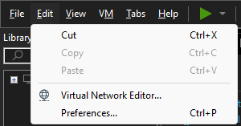

Click **Change**, select **VMnet1**, set the type to **Host-only**, and enter the following subnet IP and subnet mask:

- Subnet IP: `192.168.208.0`
- Subnet mask: `255.255.255.0`

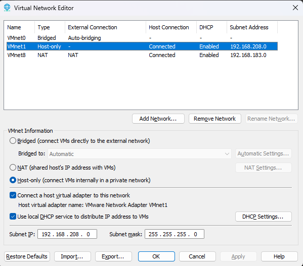

Click **DHCP Settings** and check your DHCP pool. In my case, addresses 192.168.208.1-127 are reserved for static assignment and 128-254 are dynamic. Because we do not want to lose the server's IP address, we will assign it a static IP later, for example `192.168.208.10`.

> **DHCP (Dynamic Host Configuration Protocol)** is a protocol that automatically assigns an IP address and subnet mask to network devices.

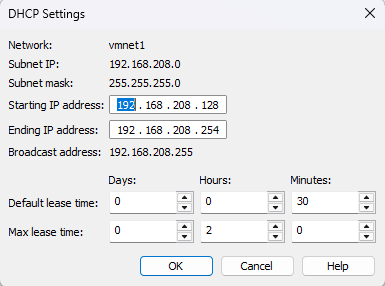

Note the IP range and click **OK**.

---

## Phase 3 - Build the Domain Controller (DC01)

**3.1** Open VMware and click **Create a New Virtual Machine**.

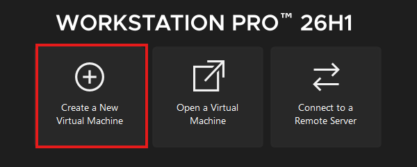

**3.2** Select **Typical (recommended)** and click **Next**.

**3.3** Select **Installer disc image file (iso)** and click **Browse**. Find the Windows Server 2022 ISO you downloaded in Phase 1 (usually named `SERVER_EVAL...`). Click **Next**.

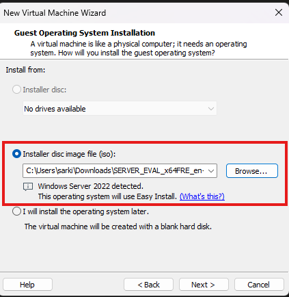

**3.4** Leave the Windows product key empty and click **Next**. A notification will ask whether you want to continue without activating Windows. The evaluation version includes a 180-day free trial, which is enough for this lab. Click **Yes**.

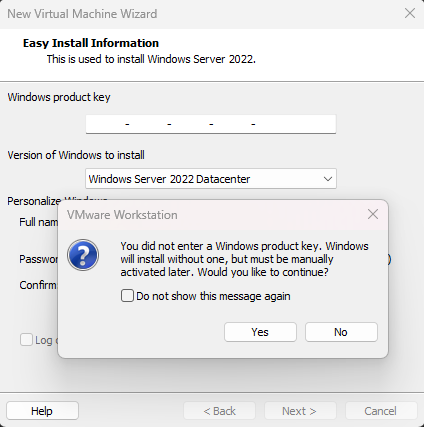

**3.5** In the "Name the Virtual Machine" window, enter `DC01` (Domain Controller 01).

**3.6** Set the disk capacity to at least **60 GB** and select **Store virtual disk as a single file**.

**3.7** On the last page, click **Customize Hardware** and set:

- **Memory:** at least 4 GB
- **Processors:** 2
- **New CD/DVD (SATA):** make sure it points to the correct ISO file
- **Network Adapter:** Host-only

Click **Close**, then **Finish**.

**3.8** After you click Finish, the VM starts automatically.

### Troubleshooting: "Windows cannot find the license terms"

At this step, you might run into the same problem I did. The message is: *Windows cannot find the license terms.*

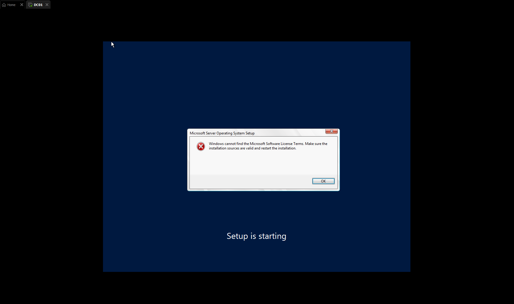

**Fix:**

1. From the toolbar menu, select **VM > Power > Power Off**.

   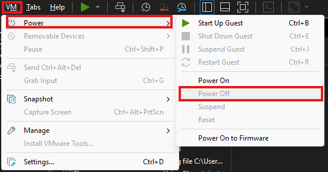

2. Select **Edit virtual machine settings**.

   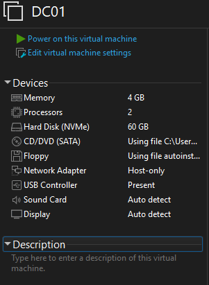

3. In the Virtual Machine Settings window, select **Floppy** and click **Remove**. Click **OK** and start the VM.

   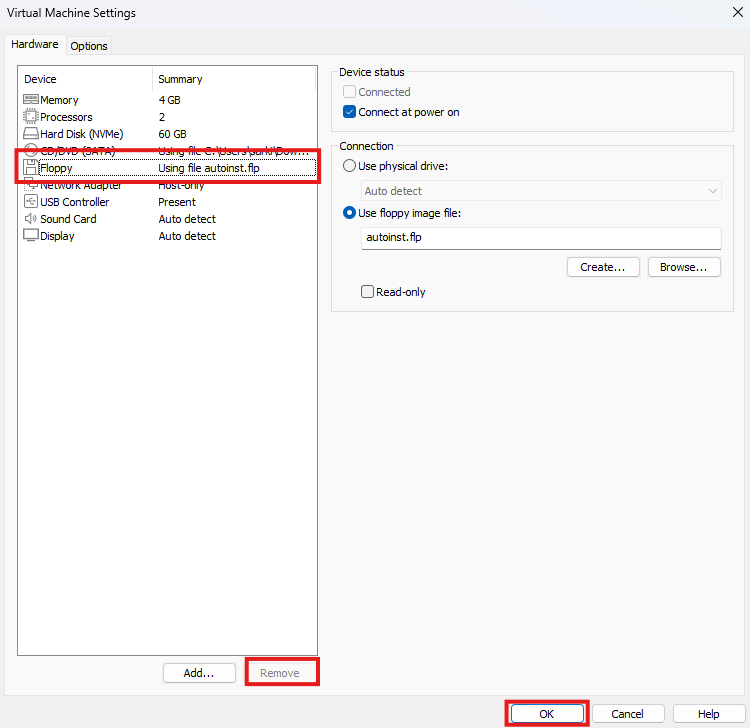

4. When the VM starts, you will be prompted to "press any key to boot from CD or DVD". Press a key immediately.

> **Note:** We removed the Easy Install floppy, which is an automated installation file. I disabled it because we want to install Windows manually.

**3.9** You should now see the first page of Windows Server setup. Select your region and language and click **Next**.

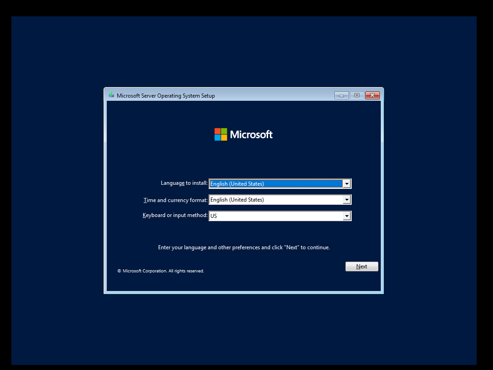

**3.10** On the next page, click **Install Now**.

**3.11** Select the Windows edition. **Make sure to select either Windows Server 2022 Standard Evaluation (Desktop Experience) or Windows Server 2022 Datacenter Evaluation (Desktop Experience). Standard is recommended, and I use the Standard version in this lab.**

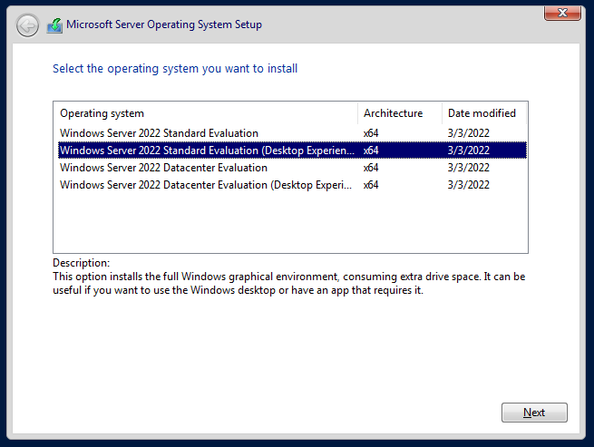

**3.12** Accept the license agreement and click **Next**. Choose **Custom installation**, select your 60 GB disk, and click **Next**. Windows will copy files and restart. You should then see the **Customize settings** window. Choose a strong password for the built-in Administrator account.

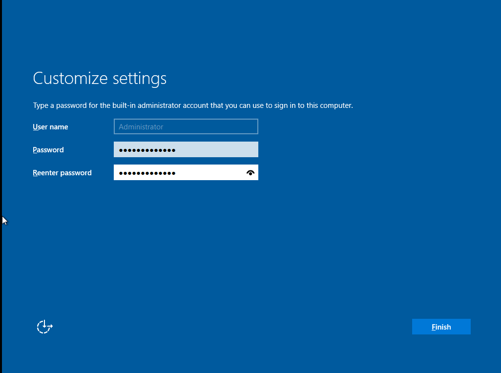

**3.13** Congratulations, you have installed Windows Server! From the toolbar, click **VM > Send Ctrl+Alt+Del**, enter your password, and you can sign in to Windows Server.

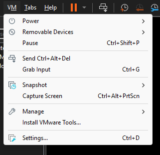

### Troubleshooting: The window is very small

You might see a very small window, which is inconvenient for the whole lab. If you have this problem, follow the steps below; otherwise, skip them.

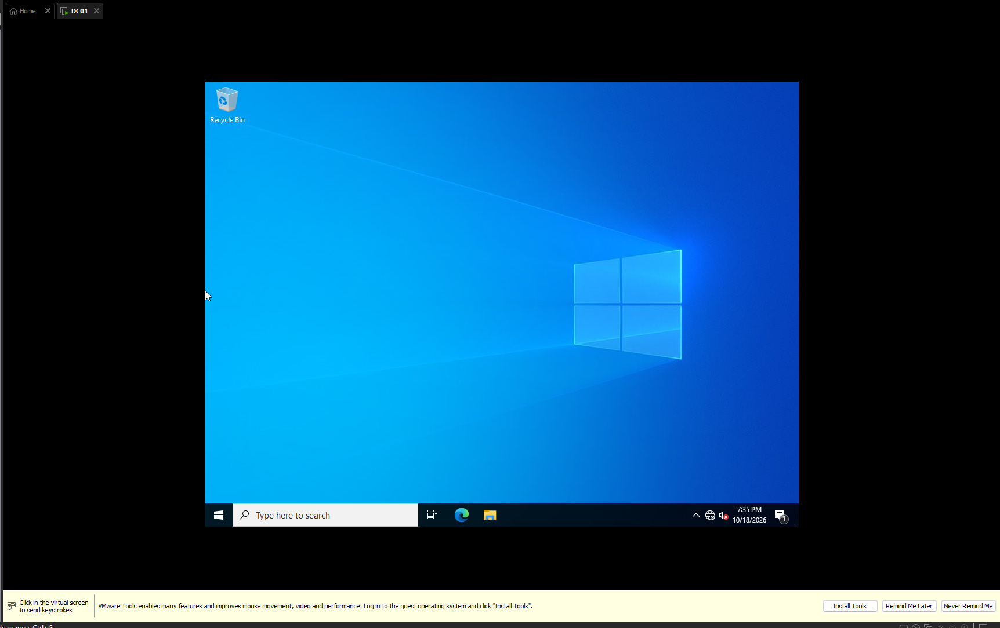

**Fix:**

1. Click **VM > Install VMware Tools**.

   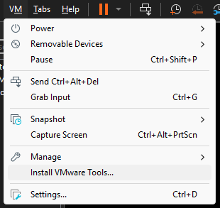

2. In the Windows Server search bar, search for **This PC** and open it.

   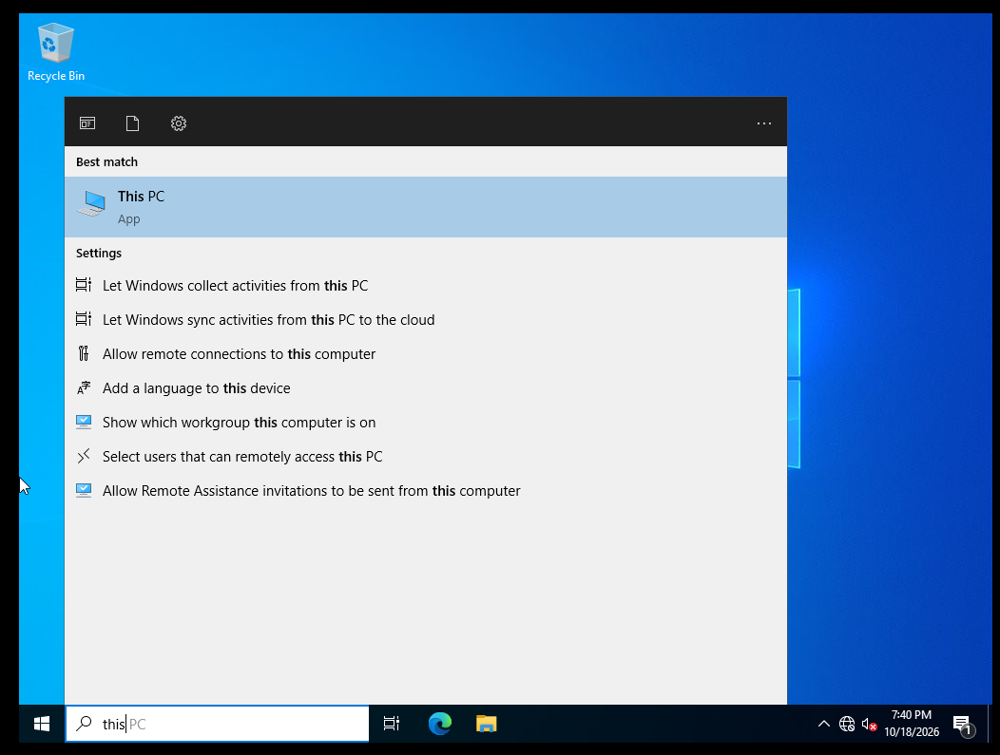

3. Double-click **DVD Drive (D:) VMware Tools** and follow the **Typical** installation.

   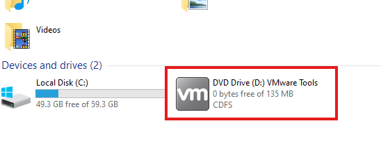

4. When the installation finishes, Windows will ask you to restart. After the restart, Windows Server should fill your screen.

   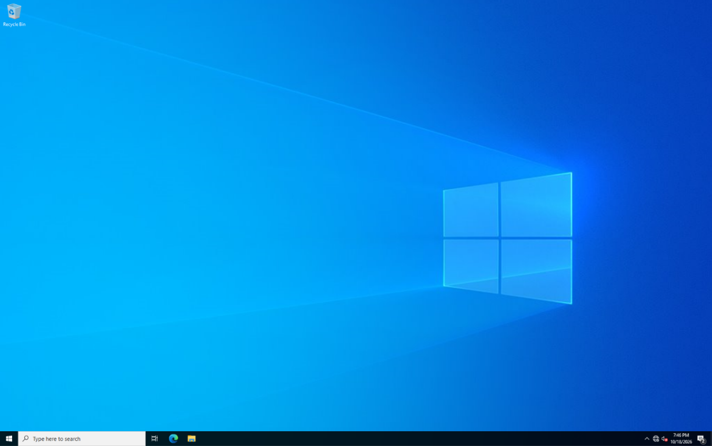

VMware Tools adjusts the resolution to fit your screen.

### Configure a Static IPv4 Address

1. Right-click the Windows icon and select **Run**, or press **Win+R**. Type `ncpa.cpl` and press Enter.
2. In the Network Connections window, right-click **Ethernet0** and select **Properties**.
3. Select **Internet Protocol Version 4 (TCP/IPv4)** and click **Properties**.
4. Select **Use the following IP address** and enter:
   - IP address: `192.168.208.10`
   - Subnet mask: `255.255.255.0`
   - Default gateway: leave empty
   - Preferred DNS server: `192.168.208.10`
5. Click **OK**, **OK**, and close the window.

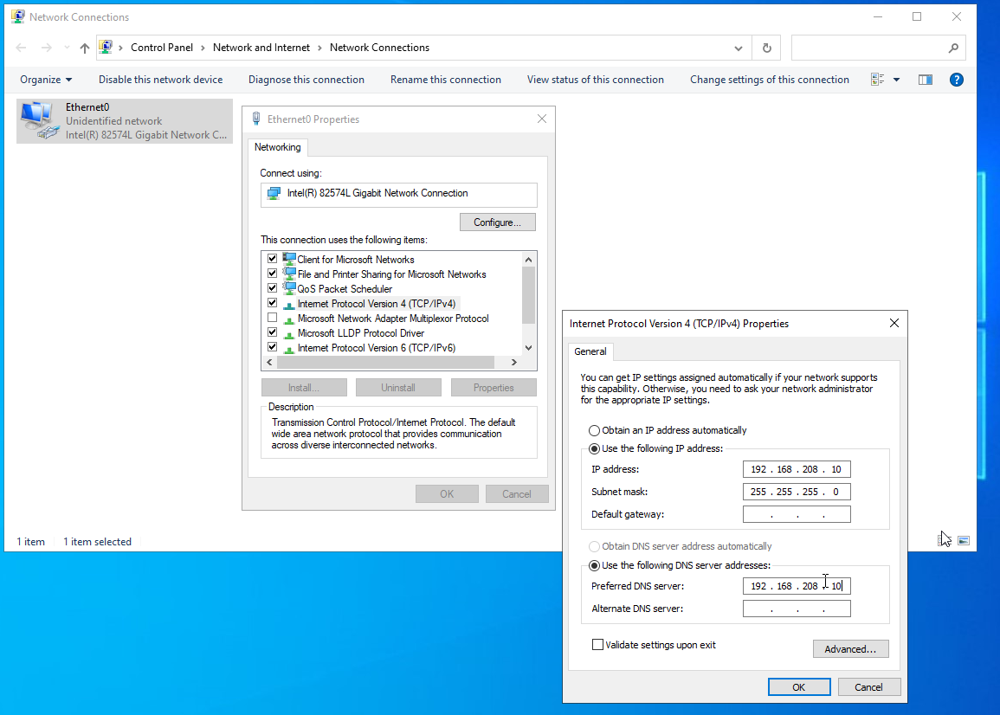

### Change the Computer Name

1. Press **Win+R**, type `sysdm.cpl`, and press Enter.
2. Click **Change** and enter `DC01` in the **Computer name** field.

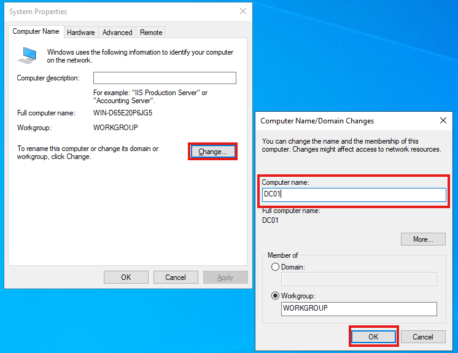

After you change the name, Windows will ask you to restart. Restart and sign in again. Now we need to confirm that the static IP address is assigned and the computer name has changed. Open Command Prompt as administrator and run these commands:

```
ipconfig
whoami
```

The result should look like the following screenshot.

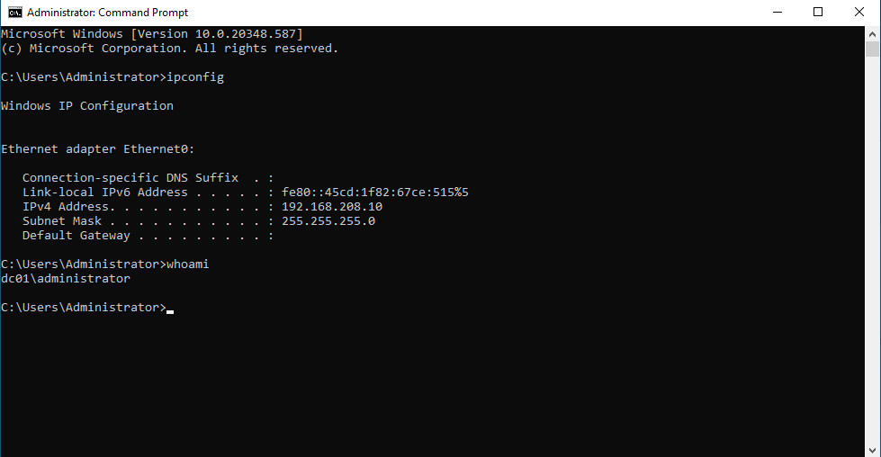

---

## Phase 4 - Install Active Directory Domain Services and DNS

AD DS acts as a centralized database that stores information about network resources and makes that data available to users and network administrators.

**4.1** To install Active Directory Domain Services (AD DS), first open **Server Manager** on DC01.

**4.2** From the top-right bar, select **Manage > Add Roles and Features**.

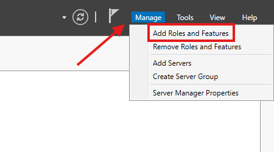

**4.3** The Add Roles and Features wizard opens. Click **Next** to reach **Installation Type**, choose **Role-based or feature-based installation**, and click **Next**.

**4.4** Select DC01 from the server pool and click **Next**.

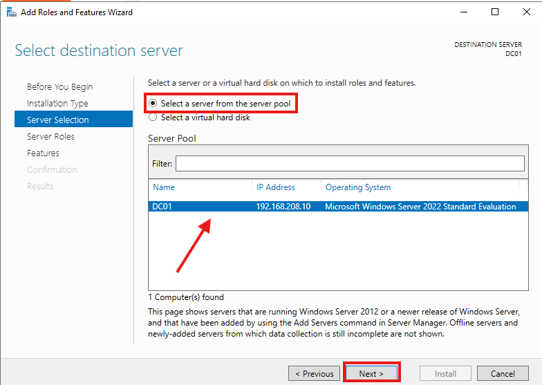

**4.5** On the **Server Roles** page, select the checkbox next to **Active Directory Domain Services**. A small window opens and asks you to confirm the features to be installed. Leave the defaults and click **Add Features**. Click **Next**.

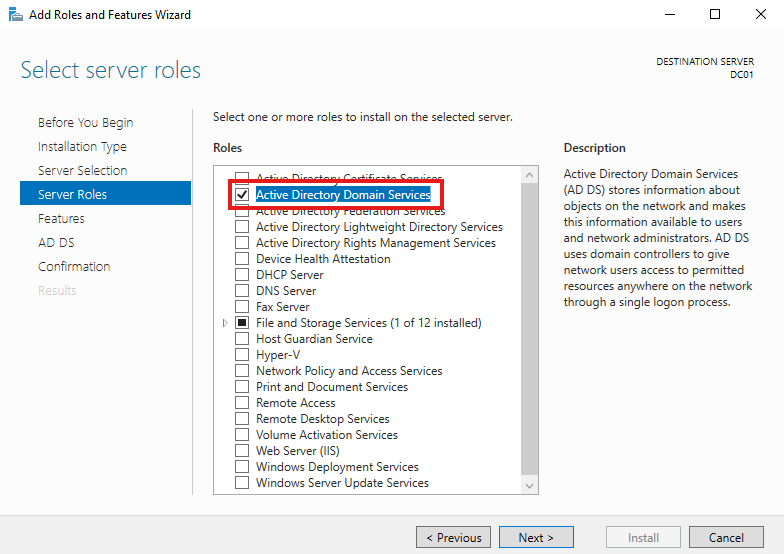

**4.6** Click **Next** until you reach the **Confirmation** page, then click **Install**.

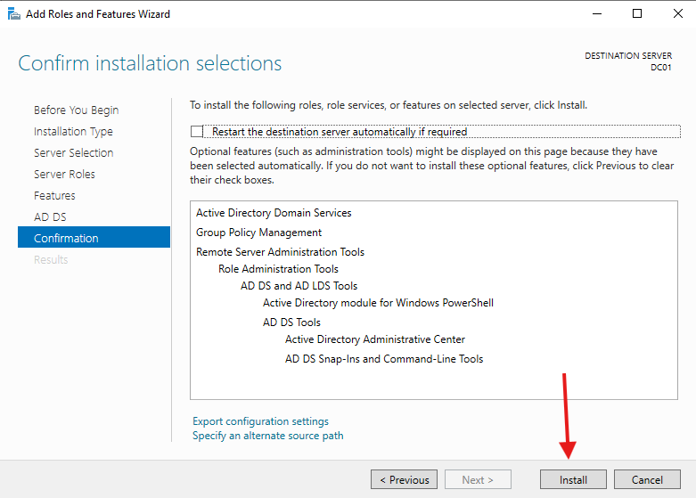

**4.7** When the installation finishes, click **Close**. Then click the flag icon with the yellow warning sign in the top-right bar and select **Promote this server to a domain controller**.

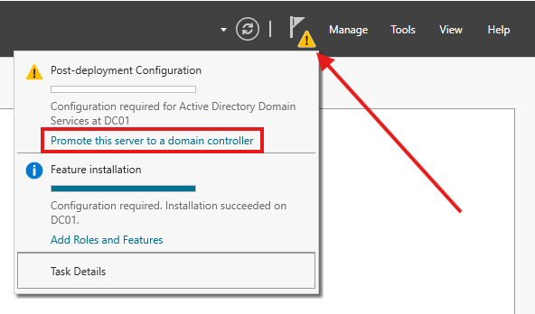

**4.8** Select **Add a new forest**. In this lab, I use `ad.tadehlab.test`. You can use your own name or any other name you want. Click **Next**.

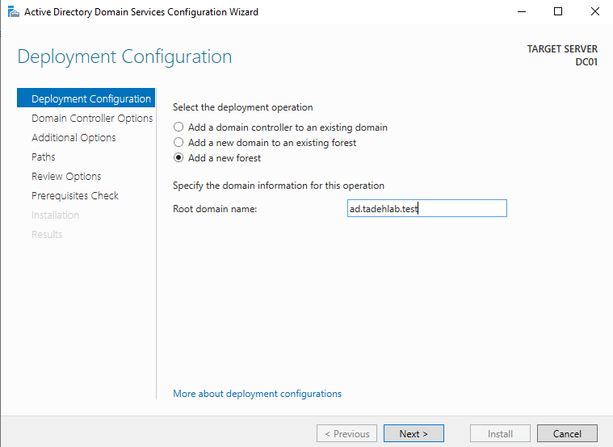

**4.9** Use the same settings as mine (forest and domain functional level: Windows Server 2016; DNS server and Global Catalog selected) and enter a **Directory Services Restore Mode (DSRM)** password. This is a separate recovery password, so choose one you can remember. Click **Next**.

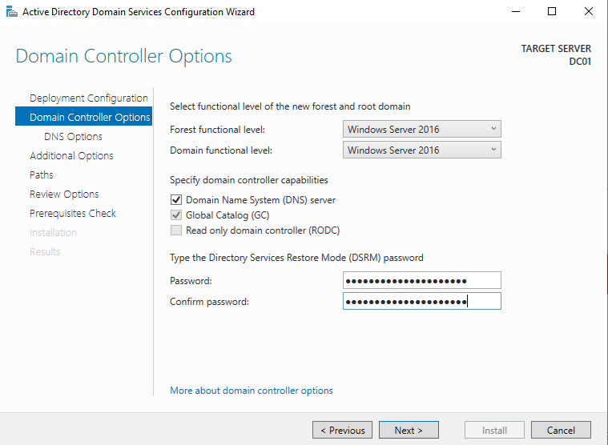

**4.10** Leave **Create DNS delegation** unchecked. Because `ad.tadehlab.test` is a brand-new private lab domain, there is no parent DNS zone that needs a delegation. Windows Server configures DNS for the domain during promotion.

**4.11** Select a NetBIOS name. I chose `TADEHLAB`, so my short logon format is `TADEHLAB\username`.

**4.12** Click **Next** until you reach **Prerequisites Check**. If you see the green check mark, you are good to go. A few yellow warnings are usually normal when you create a new forest, but if you see red errors, you must fix them. If everything looks fine, click **Install**.

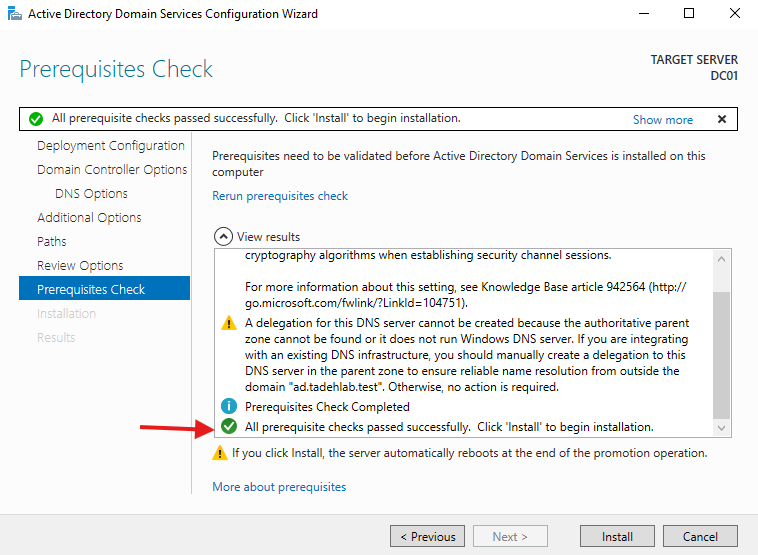

**4.13** When the installation ends, Windows restarts. This time, your logon username will be different, depending on the NetBIOS name you chose. Enter your Administrator password (not the recovery password) and sign in.

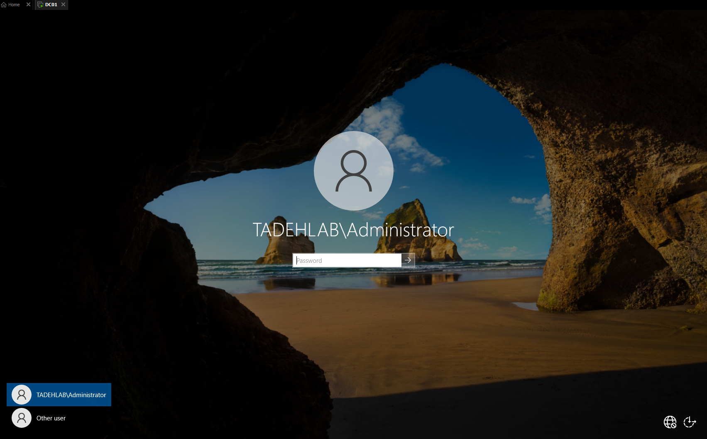

**4.14** Verify Active Directory on DC01. In Server Manager, click **Tools** in the top-right bar and select **Active Directory Users and Computers**.

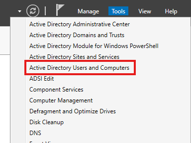

You should see your domain name. If you do, you have a working Active Directory domain controller.

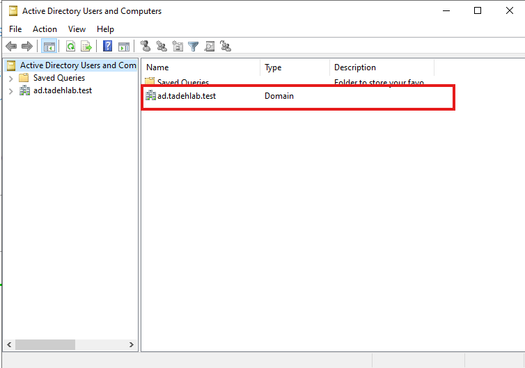

**4.15** Because Active Directory relies heavily on DNS, let's verify DNS. From **Tools**, select **DNS**.

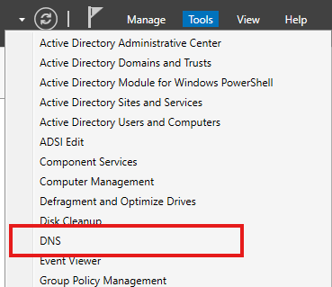

In DNS Manager:

1. Expand the server named DC01.
2. Expand **Forward Lookup Zones**.
3. You should see a zone named `ad.tadehlab.test`.
4. Click the arrow next to that zone to expand it. You should see records and folders such as `_msdcs`, `_sites`, `_tcp`, and `_udp`.

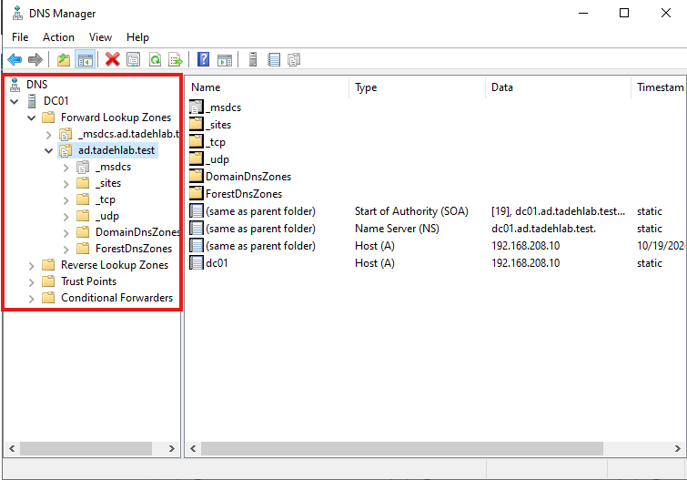

### Verify DNS Resolution

To test whether Windows can resolve the domain controller's name to its IP address, open Command Prompt or PowerShell as administrator and run:

```
nslookup dc01.ad.tadehlab.test
```

You should get an answer containing the Windows Server's IP address, the one you configured statically earlier in this lab: `192.168.208.10`.

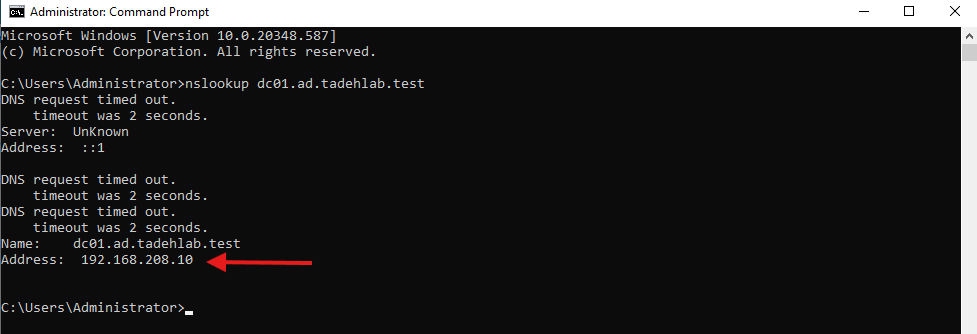

### Create the First Domain User

Domain users let employees sign in to any computer connected to the company network with one username and password, instead of having separate accounts on every machine. They also let IT manage each employee's access, permissions, and security rules from one central location (AD).

1. In Server Manager, click **Tools > Active Directory Users and Computers**.
2. Expand `ad.tadehlab.test` and right-click the **Users** folder.
3. Select **New > User**.

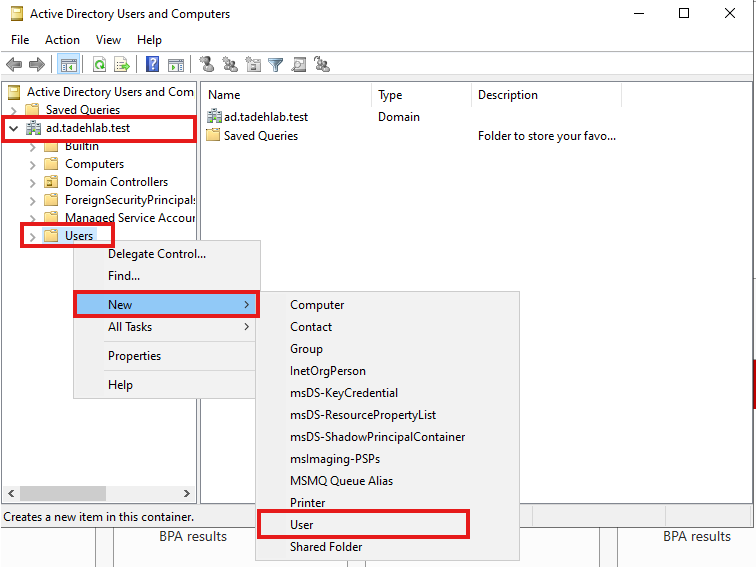

Enter the user's first name, last name, and logon name as shown in the screenshot, then enter a password for the user.

- First name: `Lab`
- Last name: `User`
- User logon name: `lab.user`

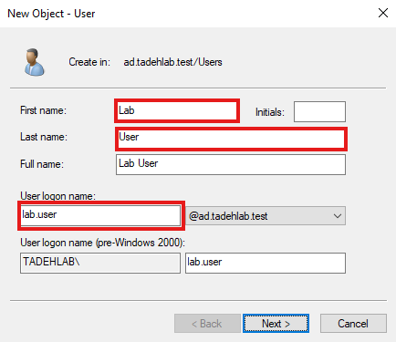

> **Note:** Because this is a lab, you can clear the option **User must change password at next logon**. In a production environment, leave it enabled.

---

## Phase 5 - Install Windows 11 Pro

Now it is time to create the client (PC01) using the Windows 11 Pro ISO you downloaded in Phase 1. The installation is not complicated: install Windows 11 Pro in VMware the same way you installed Windows Server 2022.

1. Open VMware and click **Create a New Virtual Machine**.
2. Select **Typical (recommended)**.
3. Select the location of the Windows 11 ISO file.
4. Enter the virtual machine name: `PC01`.

In the **Configure Encryption** window, enter a strong password for the virtual machine and click **Next**. Give the machine at least **80 GB** of storage and click **Next**.

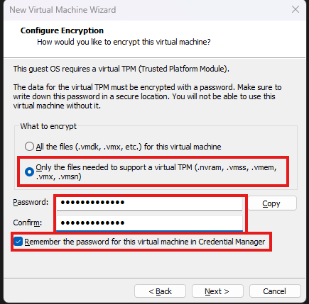

In **Customize Hardware**, set the following:

- **Memory:** 4 GB
- **Processors:** 2 cores
- **Network adapter:** Host-only
- **CD/DVD:** make sure it points to the correct ISO file

Click **Finish** and start both machines. You should see the Windows 11 installation screen. Select the language and click **Next**.

Select **Install Windows 11**, select the agreement checkbox, and click **Next**.

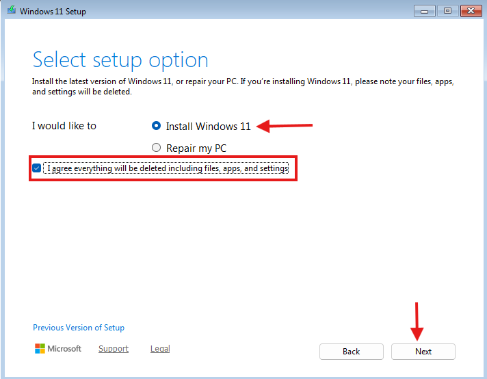

In the **Product key** window, select **I don't have a product key**. When the **Select Image** window opens, choose **Windows 11 Pro** and click **Next**.

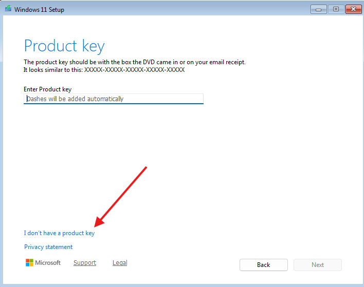

Accept the license terms and select the 80 GB disk you just created. Click **Next** until you reach **Install**.

After the installation, your machine restarts and you should see the **Select Country or region** page. Click **Next** until you reach the network connection page.

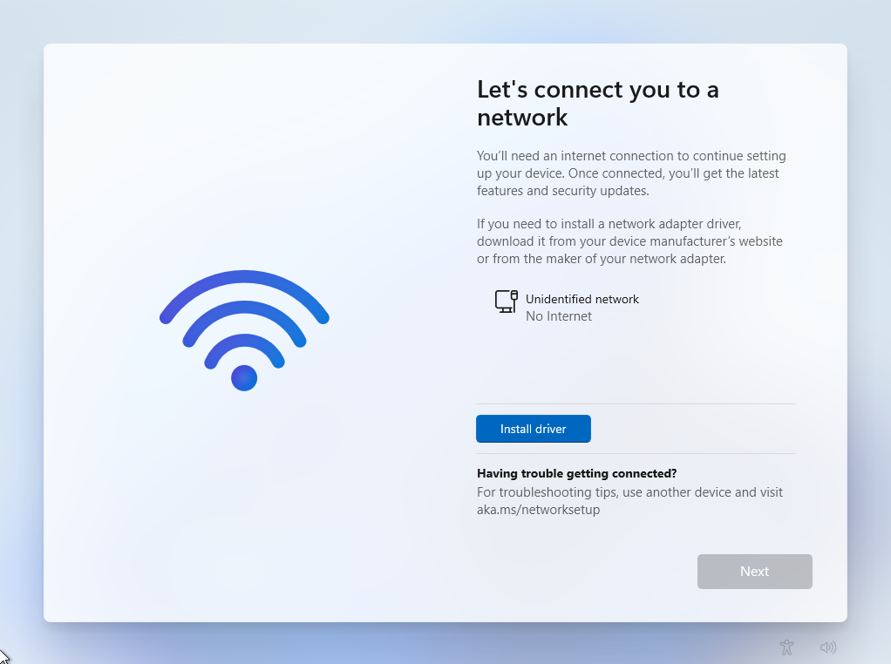

Because this is a host-only machine, we do not need an internet connection, so we will bypass this window:

1. Press **Shift+F10** (on some keyboards, **Fn+Shift+F10**). Command Prompt opens.
2. Type the following command and press Enter:

   ```
   OOBE\BYPASSNRO
   ```

3. The computer restarts. Repeat the same steps, from selecting your region until you reach the network connection window. This time, the **I don't have internet** option appears. Click it to skip this step.

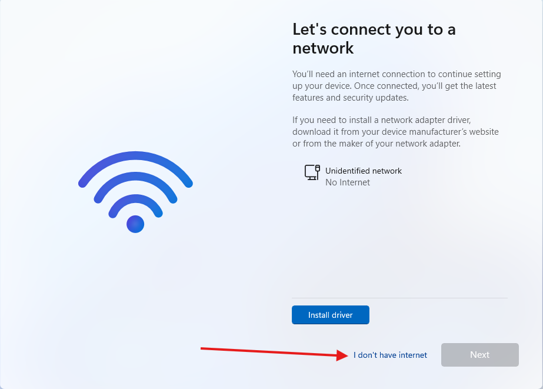

Enter `LabUser` as the account name and click **Next**.

Choose a password for the LabUser account, answer the security questions, and click **Next** until you reach the Windows 11 desktop. You have now installed Windows 11 Pro.

If the screen is small, use the same VMware Tools fix described in Phase 3 ("Troubleshooting: The window is very small").

### Rename the Computer to PC01

> **Before this step, make sure the Windows Server VM (DC01) is running.**

On PC01, press **Win+R**, type `sysdm.cpl`, and press Enter. Click **Change**, then enter `PC01` as the computer name.

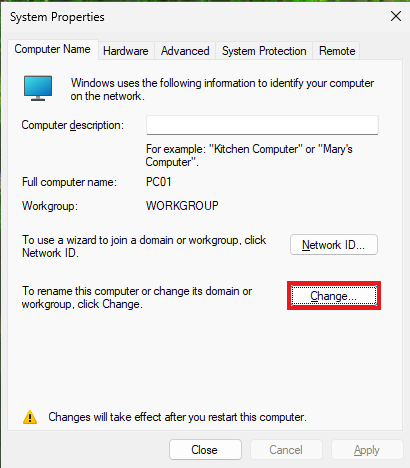

### Configure DNS on PC01

1. Press **Win+R**, type `ncpa.cpl`, and press Enter.
2. Right-click **Ethernet0** and select **Properties**.
3. Select **Internet Protocol Version 4 (TCP/IPv4)** and click **Properties**.
4. Select **Use the following DNS server addresses** and enter the Windows Server IPv4 address: `192.168.208.10`.
5. Leave the other settings as they are, click **OK**, and close the Network Connections window.

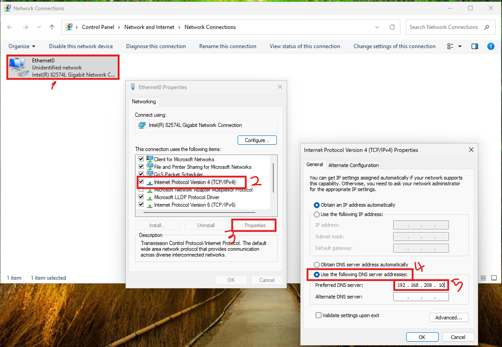

Now open Command Prompt as administrator and run the following command to test that DNS is working:

```
nslookup dc01.ad.tadehlab.test
```

You should get DC01's IPv4 address in the response: `192.168.208.10`.

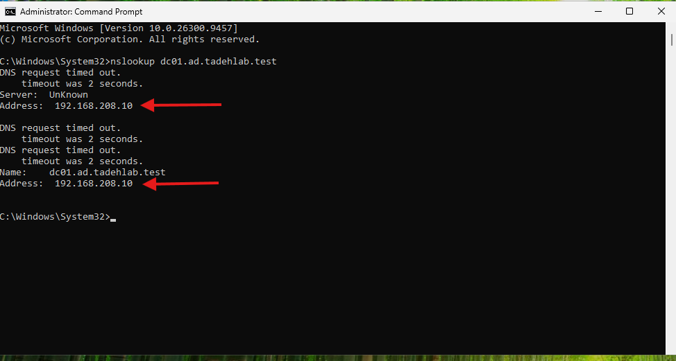

### Join PC01 to Your Active Directory Domain

1. On PC01, press **Win+R** and type `sysdm.cpl` (as you did to rename the computer).
2. Click **Change**, select **Domain** under **Member of**, and enter `ad.tadehlab.test`.

   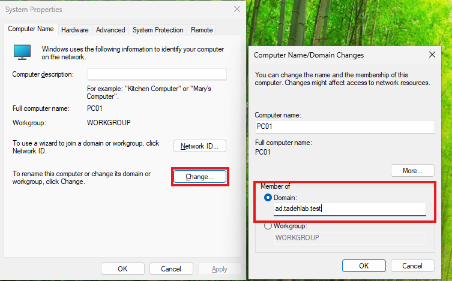

3. Windows prompts you for credentials authorized to join the domain. Use the domain Administrator account you created during the server setup:
   - Username: `TADEHLAB\Administrator`
   - Password: the Administrator password you set on DC01

   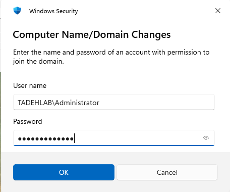

4. After Windows welcomes you to the domain, restart the computer.

After the restart, at the sign-in screen, **do not sign in with LabUser yet.** Select **Other user** and enter the domain account you created on Windows Server (`TADEHLAB\lab.user`). Enter the password and press Enter.

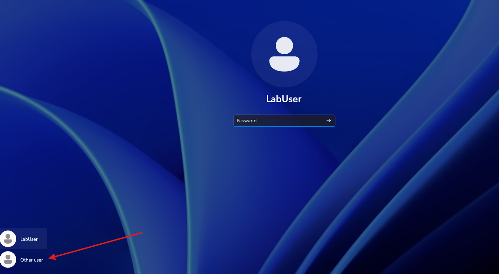

### Verify Domain Logon

Open Command Prompt and run `whoami`. You should see `tadehlab\lab.user`.

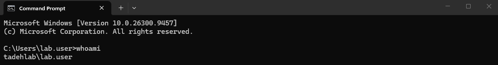

### Verify PC01 in Active Directory

Now let's confirm that the server can see PC01. On DC01, open Server Manager, go to **Tools > Active Directory Users and Computers**, expand `ad.tadehlab.test`, and click **Computers**. You should see PC01 in the list.


This computer account was created when PC01 joined the `ad.tadehlab.test` domain. Administrators in real companies use the same mechanism to centrally manage domain-connected computers.

---

## Phase 6 - Create an OU and a Group Policy

Group Policy lets administrators centrally control settings on domain computers and users, so it is an important tool to know.

### Create an Organizational Unit

On DC01, open Server Manager and click **Tools > Active Directory Users and Computers**. Right-click `ad.tadehlab.test` and select **New > Organizational Unit**.


Name it `Lab Workstation` and select **Protect container from accidental deletion**. You should now see Lab Workstation under the domain.


### Move PC01 to Lab Workstation

In the **Computers** folder, right-click **PC01**, select **Move**, choose the **Lab Workstation** OU, and click **OK**. PC01 should now appear in the Lab Workstation OU.

### Create the Group Policy Object

A Group Policy Object (GPO) is like a central rulebook for the computers and users in a company network.

1. In Server Manager, go to **Tools > Group Policy Management**.

   

2. Expand **Forest: ad.tadehlab.test > Domains > ad.tadehlab.test** and right-click **Lab Workstation**.
3. Click **Create a GPO in this domain, and Link it here**, and name it `Workstation Baseline`.

   

4. Right-click **Workstation Baseline** and click **Edit**.

   

We want to configure a policy that displays a message when a user signs in to PC01.

In the left panel, expand **Computer Configuration > Policies > Windows Settings > Security Settings > Local Policies** and click **Security Options**. In the right panel, find these two settings:

- **Interactive logon: Message title for users attempting to log on**
- **Interactive logon: Message text for users attempting to log on**


Double-click **Interactive logon: Message title for users attempting to log on**, select **Define this policy setting**, and enter `Authorized Access Only` in the text box. Click **Apply**, then **OK**.


Set the message text the same way. Enter `This computer is part of the TADEHLAB domain. Use only your authorized account.` Click **Apply**, then **OK**.

### Apply the Policy on PC01

On PC01, open Command Prompt as administrator. Because we are signed in as `lab.user`, we do not have administrator privileges, so Windows prompts for administrator credentials. Enter `TADEHLAB\Administrator` and the password you set on your Windows Server. Click **Yes**.


In Command Prompt, run:

```
gpupdate /force
```

This forces Windows to update Group Policy. To test the banner, we need to restart Windows, but first let's verify that the policy was applied.


To verify that the policy is applied, run:

```
gpresult /scope computer /r
```

You should see **Workstation Baseline** under **Applied Group Policy Objects**.


---

## Finish

Congratulations, you have finished this tutorial. Restart Windows 11 Pro, and you will see the logon banner.


